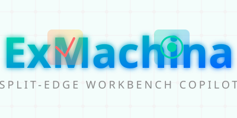

<p align="center">
  
</p>

<h1 align="center">ExMachina</h1>

<p align="center">
  <strong>A Split-Edge, Hardware-Gated Electronics Workbench Copilot</strong><br>
  <em>Combining a Raspberry Pi Pico 2 W Smart Bench Probe with an NVIDIA RTX 3050 Linux Host Brain</em>
</p>

<p align="center">
  <a href="https://github.com/Tejass1602/exmachina/actions"></a>
  <a href="https://github.com/Tejass1602/exmachina/releases"></a>
  <a href="https://github.com/Tejass1602/exmachina/blob/main/LICENSE"></a>
  <a href="https://github.com/Tejass1602/exmachina/stargazers"></a>
</p>

<p align="center">
  <a href="#-architecture"><strong>Architecture</strong></a> •
  <a href="#-hardware"><strong>Hardware</strong></a> •
  <a href="#-software-stack"><strong>Software Stack</strong></a> •
  <a href="#-milestones"><strong>Milestones</strong></a> •
  <a href="#-quick-start"><strong>Quick Start</strong></a> •
  <a href="#-research-foundations"><strong>Research</strong></a> •
  <a href="#-contributing"><strong>Contributing</strong></a>
</p>

---

## 🎯 Overview

**ExMachina** (Latin: "from the machine") is a **split-edge electronics workbench copilot** that bridges the physical and digital domains of hardware engineering. It consists of two tightly coupled halves:

```
┌─────────────────────────────────────────────────────────────────────────────┐
│                         EXMACHINA SYSTEM ARCHITECTURE                       │
├─────────────────────────────────────────────────────────────────────────────┤
│                                                                             │
│   ┌──────────────────────────┐         USB CDC-ACM (921600 baud)          │
│   │   SMART BENCH PROBE      │ ◄──────────────────────────────────────►   │
│   │   (Raspberry Pi Pico 2 W)│         Encrypted + HMAC-Signed            │
│   │   ┌────────────────────┐ │                                           │
│   │   │  RP2350A Cortex-M33│ │                                           │
│   │   │  150 MHz  • 520 KB │ │                                           │
│   │   └────────────────────┘ │                                           │
│   │   ┌────────────────────┐ │        ┌────────────────────────────┐    │
│   │   │ I2C0 (GP0/GP1)     │ │        │   LINUX HOST BRAIN         │    │
│   │   │ • Bus Scanner      │ │        │   (NVIDIA RTX 3050 6 GB)   │    │
│   │   │ • WHO_AM_I Probe   │ │        │   ┌────────────────────┐   │    │
│   │   └────────────────────┘ │        │   │  exmd Daemon       │   │    │
│   │   ┌────────────────────┐ │        │   │  • epoll + timerfd │   │    │
│   │   │ ADC0 (GP26)        │ │        │   │  • HMAC Gate       │   │    │
│   │   │ • Rail Voltage     │ │◄───────│   │  • Compiler Sandbox│   │    │
│   │   │ • Ripple Analysis  │ │        │   └─────────┬──────────┘   │    │
│   │   └────────────────────┘ │        │             │              │    │
│   │   ┌────────────────────┐ │        │   ┌─────────▼──────────┐   │    │
│   │   │ ADC1 (GP27)        │ │        │   │  CUDA Kernels      │   │    │
│   │   │ • Continuity       │ │        │   │  • Cosine Sim      │   │    │
│   │   │ • Diode/Resistor   │ │        │   │  • RRF + Top-K     │   │    │
│   │   └────────────────────┘ │        │   │  • Arena Allocator │   │    │
│   │   ┌────────────────────┐ │        │   └─────────┬──────────┘   │    │
│   │   │ I2S MEMS Mic       │ │        │             │              │    │
│   │   │ • KWS Pipeline     │ │        │   ┌─────────▼──────────┐   │    │
│   │   │ • 16 kHz / 16-bit  │ │        │   │  llama-server      │   │    │
│   │   └────────────────────┘ │        │   │  • 7B/8B Code Model│   │    │
│   │   ┌────────────────────┐ │        │   │  • IQ3_M/IQ4_XS    │   │    │
│   │   │ WL_GPIO0 LED       │ │        │   │  • KV-Cache Q8_0   │   │    │
│   │   │ • Heartbeat        │ │        │   └────────────────────┘   │    │
│   │   │ • Watchdog         │ │        │             │              │    │
│   │   └────────────────────┘ │        │   ┌─────────▼──────────┐   │    │
│   └──────────────────────────┘        │   │  Structural Indexer│   │    │
│                                       │   │  • AST Parser      │   │    │
│   Hardware-Gated, Out-of-Band         │   │  • BM25 + Hashing  │   │    │
│   Command Authorization               │   └────────────────────┘   │    │
└─────────────────────────────────────────────────────────────────────────────┘
```

### Key Innovation: **Hardware-Gated Command Authorization**

> **Problem**: LLM agents reading untrusted datasheets, compiler logs, or source repos can be hijacked via indirect prompt injection to execute destructive commands.
>
> **Solution**: ExMachina enforces an **out-of-band hardware gate**. The host daemon (`exmd`) refuses to execute privileged patches or hardware stimulus commands unless authorized by a `PKT_PROBE_INTENT` packet carrying:
> - Monotonic `seq_num` (replay protection)
> - 32-byte **RFC 2104 HMAC-SHA256** tag signed by the RP2350 using a secret key (OTP-locked in production)
> - Constant-time verification (`exm_ct_memcmp`) with `seq_num > last_valid_seq` enforcement

---

## 🔬 Hardware

### Smart Bench Probe (Raspberry Pi Pico 2 W)

| Pin / Peripheral | Function | Electrical / Circuit Detail |
|:-----------------|:---------|:----------------------------|
| `GP0` / `GP1` (`i2c0`) | **Digital Bus Sniffer** | 3.3V I2C sweep (`0x08..0x77`) + `WHO_AM_I` register probe (`0x0F`, `0x75`, `0xD0`) |
| `GP26` (`ADC0`) | **Rail Voltage & Ripple Probe** | Behind 10:1 resistor divider (`100 kΩ` / `10 kΩ`, safe up to ~30V). 256 samples in 2 ms → `rail_mV = mean × 11`, `ripple_mV = (max-min) × 11` |
| `GP27` (`ADC1`) | **Component / Continuity Probe** | 1 kΩ pull-up to 3.3V reference for resistor/diode/short sanity checks |
| `USB` (Full-Speed) | **Composite CDC-ACM + HID** | `/dev/ttyACM0` (921600 baud raw binary) + USB HID keyboard for emergency `Ctrl+C` halt |
| `WL_GPIO0` | **Status / Watchdog LED** | Heartbeat indicator; blinks rapidly if host `exmd` heartbeat times out (> 2000 ms) |
| `I2S` (GP18/GP19/GP20) | **MEMS Microphone** | PDM/PCM for keyword spotting (Arm DS-CNN / CMSIS-DSP) |

### Host Brain Requirements

| Component | Specification |
|:----------|:--------------|
| **GPU** | NVIDIA RTX 3050 Laptop (`sm_86`, 6 GB VRAM) |
| **OS** | Linux (tested on Arch/Ubuntu 22.04+) |
| **CUDA** | 12.x |
| **RAM** | ≥ 16 GB system RAM |
| **Storage** | ≥ 10 GB free (model weights + indices) |

### VRAM Budget (RTX 3050 6 GB)

```
┌────────────────────────────────────────────────────────────────────┐
│                    VRAM ALLOCATION (6144 MB)                       │
├──────────────────────┬──────────────┬─────────────────────────────┤
│ Component            │ Size         │ Purpose                     │
├──────────────────────┼──────────────┼─────────────────────────────┤
│ CUDA Arena           │ 64 MB        │ Flat allocator (256-byte    │
│                      │              │ aligned, O(1) reset)        │
├──────────────────────┼──────────────┼─────────────────────────────┤
│ LLM (7B IQ3_M)       │ ~3.5 GB      │ llama-server weights        │
├──────────────────────┼──────────────┼─────────────────────────────┤
│ KV Cache (Q8_0)      │ ~500 MB      │ 8192 ctx × 32 layers        │
├──────────────────────┼──────────────┼─────────────────────────────┤
│ Desktop Compositor   │ ~500 MB      │ KDE/GNOME + display         │
├──────────────────────┼──────────────┼─────────────────────────────┤
│ Headroom             │ ~1.5 GB      │ Safety margin               │
└──────────────────────┴──────────────┴─────────────────────────────┘
```

---

## 🧠 Software Stack

### Technology Map

```
EXMACHINA SOFTWARE LAYERS
═══════════════════════════════════════════════════════════════════════════════

┌─────────────────────────────────────────────────────────────────────────────┐
│                              APPLICATIONS                                    │
│  ┌─────────────┐  ┌─────────────┐  ┌─────────────┐  ┌─────────────────────┐ │
│  │  exmd       │  │ exm-bench   │  │ mic_bridge  │  │  Structural Indexer │ │
│  │  (Daemon)   │  │ (Benchmark) │  │  (Python)   │  │  (AST + BM25)       │ │
│  └──────┬──────┘  └──────┬──────┘  └──────┬──────┘  └──────────┬──────────┘ │
└─────────┼────────────────┼────────────────┼─────────────────────┼────────────┘
          │                │                │                     │
┌─────────┼────────────────┼────────────────┼─────────────────────┼────────────┐
│         ▼                ▼                ▼                     ▼            │
│  ┌─────────────────────────────────────────────────────────────────────────┐ │
│  │                      SHARED PROTOCOL (exm_packet.h)                      │ │
│  │  • Packed C structs (8B header + 4 payloads)                            │ │
│  │  • CRC-16/CCITT-FALSE • HMAC-SHA256 • Constant-time memcmp              │ │
│  └─────────────────────────────────────────────────────────────────────────┘ │
└─────────────────────────────────────────────────────────────────────────────┘
          │                │                │                     │
┌─────────┼────────────────┼────────────────┼─────────────────────┼────────────┐
│         ▼                ▼                ▼                     ▼            │
│  ┌─────────────────────────────────────────────────────────────────────────┐ │
│  │                        CUDA KERNELS (sm_86)                             │ │
│  │  ┌──────────────────┐  ┌──────────────────┐  ┌──────────────────────┐  │ │
│  │  │ Cosine Similarity│  │ RRF + Top-K      │  │ Flat Arena Allocator │  │ │
│  │  │ • Warp-shuffle   │  │ • Rank fusion    │  │ • 64 MB pre-alloc    │  │ │
│  │  │ • 384-dim        │  │ • 1/(60+r) formula│ │ • 256-byte align    │  │ │
│  │  │ • <0.1 ms @10k   │  │ • <5 ms @10k     │  │ • 100x cudaMalloc    │  │ │
│  │  └──────────────────┘  └──────────────────┘  └──────────────────────┘  │ │
│  └─────────────────────────────────────────────────────────────────────────┘ │
└─────────────────────────────────────────────────────────────────────────────┘
          │                │                │                     │
┌─────────┼────────────────┼────────────────┼─────────────────────┼────────────┐
│         ▼                ▼                ▼                     ▼            │
│  ┌─────────────────────────────────────────────────────────────────────────┐ │
│  │                      FIRMWARE (Zephyr RTOS)                             │ │
│  │  • I2C Bus Scanner (0x08–0x77 + WHO_AM_I)                              │ │
│  │  • ADC Rail Probe (256× @ 2ms, 10:1 divider)                           │ │
│  │  • Continuity/Diode Probe (ADC1)                                       │ │
│  │  • USB CDC-ACM + HMAC Intent Signing                                   │ │
│  │  • 500ms Heartbeat + Watchdog                                          │ │
│  │  • KWS Pipeline Stub (Arm DS-CNN)                                      │ │
│  └─────────────────────────────────────────────────────────────────────────┘ │
└─────────────────────────────────────────────────────────────────────────────┘
```

### Core Libraries

| Library | Purpose | Key Features |
|:--------|:--------|:-------------|
| **`shared/exm_packet.h`** | Wire protocol | Packed structs, CRC-16, HMAC, const-time memcmp |
| **`arena.cuh`** | GPU memory | Flat allocator, 256B alignment, O(1) reset |
| **`rrf_topk.cuh`** | Retrieval | Warp-shuffle cosine, RRF fusion, Top-K |
| **`indexer.cpp`** | Code search | AST parser, BM25, feature-hash embeddings |
| **`hmac_sha256.h`** | Crypto | RFC 2104 HMAC-SHA256, RFC 4231 test vectors |
| **`sandbox.cpp`** | Compiler gate | Unified diff parser, temp dir, nvcc/g++ verify |

---

## 📋 Milestones

| # | Milestone | Deliverables | Status |
|:--|:----------|:-------------|:-------|
| **M1** | **Shared Protocol & CUDA Arena** | `exm_packet.h`, `arena.cuh`, `exm-bench` (CRC-16, 7× `cudaMalloc` speedup) | ✅ Done |
| **M2** | **Mic Bridge** | `mic_bridge.py` (live `parec` + `--loopback` self-test) | ✅ Done |
| **M3** | **CUDA Hybrid Retrieval** | `cosine_sim` (warp-shuffle), `RRF+Top-K` (exact match, <5 ms) | ✅ Done |
| **M4** | **Structural Indexer** | AST parser (C/C++/MD), BM25 (k₁=1.5, b=0.75), 384-dim feature hashing | ✅ Done |
| **M5** | **Host Daemon** | `exmd` (epoll/timerfd, HMAC gate, compiler sandbox, GBNF grammar) | ✅ Done |
| **M6** | **Zephyr Firmware** | RP2350A probe (I2C scan, ADC rail, CDC-ACM, HMAC signing, heartbeat) | ✅ Done |

### Acceptance Gates (All Passing)

```bash
# M1: Protocol + Arena
$ cmake -B host/build -S host && cmake --build host/build -j && ./host/build/exm-bench
# → CRC-16 PASS, Arena 7× speedup, 145 GB/s bandwidth

# M2: Mic Bridge
$ python3 tools/mic_bridge.py --loopback
# → 5/5 packet tests PASS

# M3: CUDA Retrieval
$ ./host/build/exm-bench
# → Cosine max_abs_err=0, Top-8 exact match, 4.6 ms latency

# M4: Indexer
$ ./host/build/exm-bench
# → "ExmProbeIntent hmac_sha256" → Rank #1 chunk

# M5: Daemon
$ ./host/build/exmd --mock-serial
# → 4/4 security tests PASS (valid/tampered/replay/sandbox)

# M6: Firmware
$ arm-none-eabi-gcc -c firmware/src/main.c -I...  # Syntax check PASS
```

---

## 🚀 Quick Start

### Prerequisites

```bash
# Host dependencies (Arch Linux example)
sudo pacman -S cuda nvcc cmake gcc make python pulseaudio zeromq

# For llama-server (GGUF model server)
# Download a 7B/8B code model (e.g., deepseek-coder-6.7b-instruct.Q4_K_M.gguf)
# Run: llama-server -m model.gguf -c 8192 --port 8080
```

### Build Host Stack

```bash
cd host
cmake -B build -S .
cmake --build build -j$(nproc)

# Run benchmarks
./build/exm-bench

# Run daemon (mock mode for testing)
./build/exmd --mock-serial
```

### Build Firmware (Zephyr)

```bash
# Install Zephyr SDK
west init -m https://github.com/zephyrproject-rtos/zephyr --mr v3.6.0 ~/zephyrproject
cd ~/zephyrproject && west update && west zephyr-export
pip install -r ~/zephyrproject/zephyr/scripts/requirements.txt

# Build ExMachina probe
cd firmware
west build -b rpi_pico2/rp2350a/m33/w . -d build

# Flash to Pico 2 W (BOOTSEL mode)
west flash --runner=picotool
```

### Run Full System

```bash
# Terminal 1: Start LLM server
llama-server -m deepseek-coder-6.7b-instruct.Q4_K_M.gguf -c 8192 --port 8080

# Terminal 2: Start host daemon
cd host/build && ./exmd --port /dev/ttyACM0 --llm-url http://127.0.0.1:8080/completion

# Terminal 3: (Optional) Stream microphone
cd ../../tools && python3 mic_bridge.py --port /dev/ttyACM0

# Terminal 4: Monitor probe telemetry
screen /dev/ttyACM0 921600
```

---

## 🔬 Research Foundations

Every core subsystem adopts a specific published methodology:

| Subsystem | Reference | Implementation |
|:----------|:----------|:---------------|
| **Indirect Prompt Injection Defense** | Greshake et al., *AISec 2023* | Out-of-band HMAC gate with monotonic seq_num |
| **HMAC-SHA256** | Krawczyk, Bellare, Canetti, *RFC 2104* | Constant-time verification, RFC 4231 test vectors |
| **Microcontroller KWS** | Zhang et al., *Arm Research, arXiv:1711.07128* | DS-CNN / CMSIS-DSP: 16 kHz, 30-40 ms frames, log-Mel INT8 |
| **GPU Arena Allocation** | NVIDIA, *Ampere Tuning Guide (sm_86)* | 64 MB slab, 256B alignment, O(1) reset |
| **Warp-Shuffle Reduction** | Harris, *NVIDIA 2007* | `__shfl_down_sync` for cosine similarity |
| **Reciprocal Rank Fusion** | Cormack et al., *SIGIR 2009* | `RRF = 1/(60+r_dense) + 1/(60+r_sparse)` |
| **Okapi BM25** | Robertson & Zaragoza, *FnTIR 2009* | k₁=1.5, b=0.75 for exact hex/register/pin matching |
| **QLoRA Fine-tuning** | Dettmers et al., *NeurIPS 2023* | 7B IQ3_M/IQ4_XS (~3.5–4.1 GB VRAM) |
| **KV Cache Quantization** | Hooper et al., *2024* | Q8_0 KV cache for 2 GB VRAM headroom |

---

## 📁 Repository Structure

```
exmachina/
├── AGENTS.md                    # Agent instructions
├── SPEC.md                      # Full technical specification
├── README.md                    # This file
├── LICENSE                      # MIT License
├── docs/
│   ├── architecture.svg         # System architecture diagram
│   ├── hardware.svg             # Pinout & circuit diagrams
│   └── logo.svg                 # Project logo
├── shared/
│   └── exm_packet.h             # Wire protocol (single source of truth)
├── host/
│   ├── CMakeLists.txt
│   ├── include/
│   │   ├── core/arena.cuh       # Flat CUDA arena
│   │   ├── kernels/rrf_topk.cuh # Cosine + RRF + Top-K
│   │   ├── ast/indexer.h        # Structural indexer API
│   │   └── daemon/
│   │       ├── hmac_sha256.h    # Crypto primitives
│   │       └── sandbox.h        # Compiler sandbox API
│   ├── src/
│   │   ├── main_bench.cu        # M1+M3+M4 benchmarks
│   │   ├── kernels/rrf_topk.cu
│   │   ├── ast/indexer.cpp      # AST parser + BM25 + embeddings
│   │   └── daemon/
│   │       ├── exmd.cpp         # Linux daemon (epoll/timerfd)
│   │       └── sandbox.cpp      # Unified diff + compiler gate
│   └── grammars/unified_diff.gbnf
├── tools/
│   └── mic_bridge.py            # Live audio + loopback test
└── firmware/
    ├── CMakeLists.txt
    ├── prj.conf                 # Zephyr Kconfig
    ├── boards/rpi_pico2/...     # Board definition
    ├── zephyr/include/...       # Minimal Zephyr headers (for CI)
    └── src/main.c               # Probe firmware
```

---

## 🤝 Contributing

We welcome contributions! Please see [CONTRIBUTING.md](CONTRIBUTING.md) for details.

### Development Workflow

```bash
# 1. Fork & clone
git clone https://github.com/yourfork/exmachina.git
cd exmachina

# 2. Create feature branch
git checkout -b feat/amazing-feature

# 3. Make changes, run tests
./host/build/exm-bench          # Must pass
./host/build/exmd --mock-serial # Must pass
python3 tools/mic_bridge.py --loopback

# 4. Commit with conventional messages
git commit -m "feat(kernel): add INT8 quantization to cosine kernel"

# 5. Push & open PR
git push origin feat/amazing-feature
```

### Code Standards

- **C/C++**: C++20, CUDA 20, `-O3 -Wall -Wextra`
- **Python**: 3.10+, type hints, `py_compile` clean
- **C (Zephyr)**: C11, `-std=c11 -Wall -Wextra`
- **Documentation**: Doxygen-style comments for public APIs

---

## 📄 License

Distributed under the **MIT License**. See `LICENSE` for more information.

---

## 🙏 Acknowledgments

- **NVIDIA** for CUDA warp-shuffle primitives and Ampere architecture docs
- **Arm Research** for the DS-CNN KWS reference implementation
- **Zephyr Project** for the excellent RTOS framework
- **ggml/llama.cpp** team for efficient local LLM inference
- **Greshake et al.** for the indirect prompt injection threat model
- **Raspberry Pi** for the Pico 2 W (RP2350A) development board

---

## 📊 Project Status

<p align="center">
  
  
  
  
  
  
</p>

<p align="center">
  <strong>All 6 milestones complete • Ready for hardware bring-up</strong>
</p>

---

<p align="center">
  Made with ❤️ for hardware engineers who want their workbench to think alongside them.
</p>

<p align="center">
  <a href="https://github.com/Tejass1602/exmachina">⭐ Star us on GitHub</a> •
  <a href="https://github.com/Tejass1602/exmachina/issues">🐛 Report Bug</a> •
  <a href="https://github.com/Tejass1602/exmachina/discussions">💬 Discuss</a>
</p>